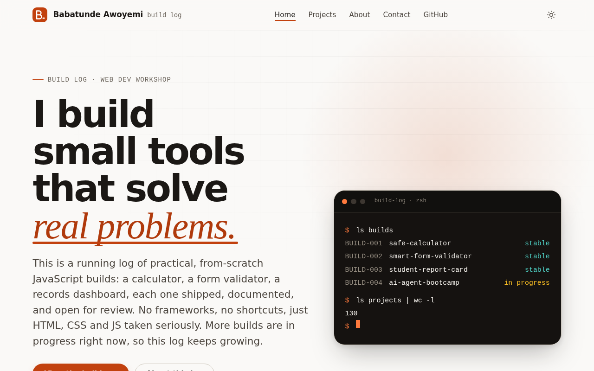
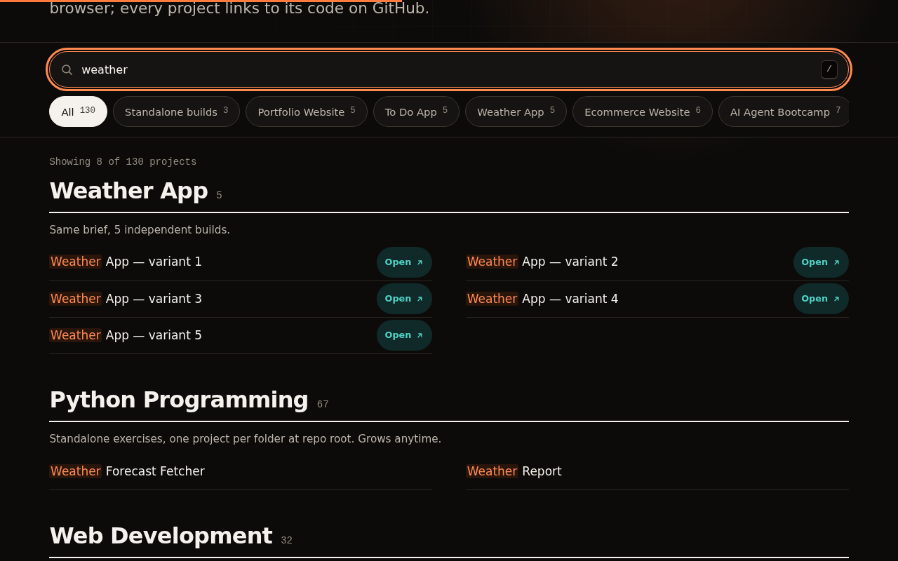

<p align="center">
  <picture>
    <source media="(prefers-color-scheme: dark)" srcset="docs/assets/logo-dark.svg">
    
  </picture>
</p>

<h1 align="center">Build Log</h1>

<p align="center">
  A running log of practical, from-scratch web and Python projects by <a href="https://github.com/babatundeawo">Babatunde Awoyemi</a>.<br>
  <a href="https://babatundeawo.github.io/personal-projects/"><strong>Open the live site</strong></a>
</p>

<p align="center">
  
  
</p>

<picture>
  <source media="(prefers-color-scheme: dark)" srcset="docs/assets/preview-dark.png">
  
</picture>

## What is here

This repository is a personal coding workspace. Every project lives in its own folder with its own README, and the website at the top of the repository is the front door to all of them.

- **Home** introduces the four main builds.
- **Projects** is a searchable index of every project, with an **Open** link for the ones that run in a browser.
- **About** and **Contact** explain the workspace and how to get in touch.



## The site works like an app

- **Installable.** On Android, Chrome and Edge offer an **Install app** button. On iPhone, the site shows three short steps for Safari's Add to Home Screen.
- **Works offline.** After a first visit, the pages open without internet. A calm banner tells you when you are offline.
- **Updates safely.** When a new version is published, a small prompt offers **Refresh**; it never reloads the page under you.
- **Fast and private.** No trackers, no external fonts, no third-party scripts. Each page is roughly 20 KB compressed before fonts.
- **Accessible.** Keyboard friendly, visible focus, readable contrast in both light and dark themes, and respect for the reduced-motion setting.

## How it is built

Plain HTML, CSS and JavaScript with no framework. A small script, `scripts/build.mjs`, runs on GitHub's servers every time you save a change to `main`. It assembles the pages from shared pieces (header, footer), builds the project list from `data/projects.json`, creates the offline service worker and app manifest, checks everything, and publishes the result to GitHub Pages.

```
.
├── index.html, projects.html, about.html, contact.html, 404.html, offline.html   Page templates
├── partials/        Shared header, footer and app-style interface
├── data/            projects.json (the project list) and site.json (names)
├── assets/          Styles, scripts, fonts (added on build) and screenshots
├── scripts/         build.mjs, the build and check script
├── sw.js, site.webmanifest   Templates for the offline worker and the install manifest
├── docs/            Guides for running the site
└── (project folders)  Everything else: one folder per project
```

## Run and update it

You do not need to install anything. Edit files on github.com, commit, and the site updates a minute or two later.

- [Deployment](docs/DEPLOYMENT.md): how publishing works and what to do if it fails.
- [Customizing](docs/CUSTOMIZING.md): change words, colors, the project list and the email address.
- [Contributing](CONTRIBUTING.md) and [Security](SECURITY.md).

## Credits

Fonts: [Geist and Geist Mono](https://vercel.com/font) (SIL Open Font License) and [Instrument Serif](https://fonts.google.com/specimen/Instrument+Serif) (SIL Open Font License), self-hosted through [Fontsource](https://fontsource.org).
