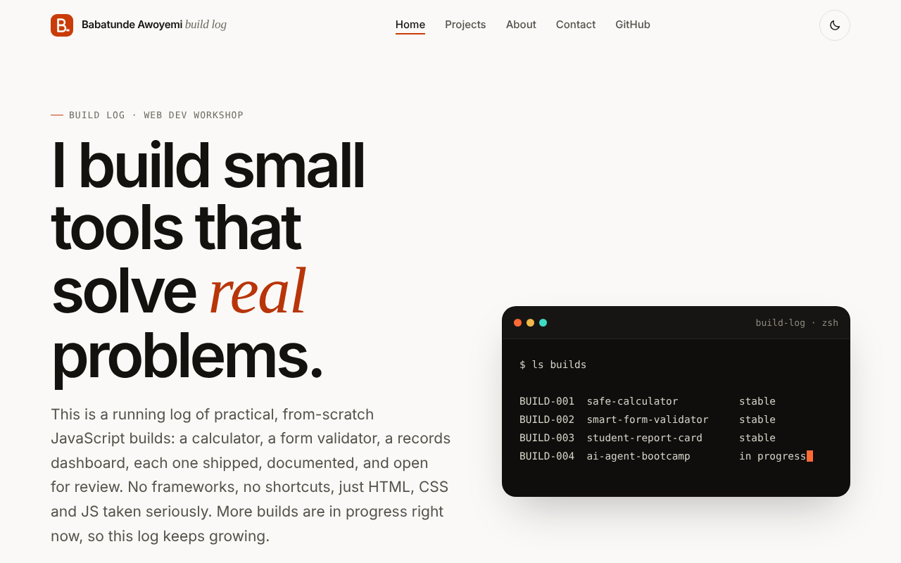
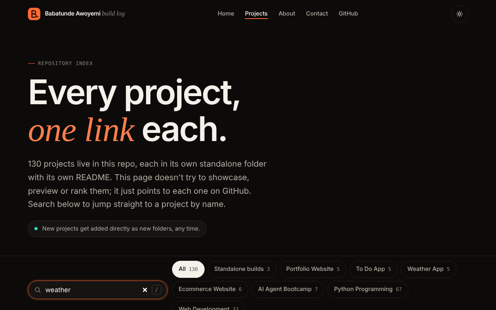

<div align="center">

<picture>
  <source media="(prefers-color-scheme: dark)" srcset="docs/assets/logo-dark.svg">
  
</picture>

# Babatunde Awoyemi: Build Log

**A running log of practical, from-scratch web and Python projects, each one in its own folder.**

[](https://github.com/babatundeawo/personal-projects/actions/workflows/deploy.yml)
[](https://babatundeawo.github.io/personal-projects/)
[](https://github.com/babatundeawo/personal-projects/actions/workflows/codeql.yml)

[Live site](https://babatundeawo.github.io/personal-projects/) &nbsp;·&nbsp; [All projects](https://babatundeawo.github.io/personal-projects/projects.html) &nbsp;·&nbsp; [Report an issue](https://github.com/babatundeawo/personal-projects/issues/new/choose)

</div>

<picture>
  <source media="(prefers-color-scheme: dark)" srcset="docs/assets/preview-dark.png">
  
</picture>

## About

This repository is a personal coding workspace. Every project starts as a small learning exercise and is rebuilt until it holds up to real use. There are 130 projects: a few polished standalone builds, several "same brief, five independent attempts" comparisons, an AI agent bootcamp, and a large set of smaller Python and web exercises.

The site in the repository root is the front door to all of it: a home page, a searchable index, an about page and a contact page.

## Features

- A searchable index of all 130 projects, with filters by collection. Press `/` to jump to the search box.
- Light and dark themes that follow your device setting and remember your choice.
- Works on phones, tablets and desktops, with keyboard navigation and reduced-motion support.
- A contact form that opens your email app with the message pre-filled.
- Every project links straight to its folder on GitHub.

## How to use it

1. Open the [live site](https://babatundeawo.github.io/personal-projects/).
2. Go to **Projects** and search by name, or pick a collection.
3. Open any project to read its code on GitHub. Projects that have an `index.html` can also be opened in a browser.

<picture>
  
</picture>

## Tech stack

- Semantic HTML5, modern CSS (custom properties, grid) and vanilla JavaScript. No framework and no build step for the site itself.
- Python for the exercises and the AI agent bootcamp.
- GitHub Actions for checks and GitHub Pages for hosting.

## Project structure

```text
.
├── index.html, projects.html, about.html, contact.html, 404.html   The site
├── assets/            Shared styles, scripts and page code for the site
├── docs/              Guides for running the site
├── .github/           Automation (deploy, security scan) and issue templates
├── safe-calculator/, smart-form-validator/, student-report-card/   Standalone builds
├── ai-agent-bootcamp/ Project-00 to Project-06
└── …                  One folder per project, each with its own README where needed
```

## Contributing

Found a bug or have an idea? [Open an issue](https://github.com/babatundeawo/personal-projects/issues/new/choose). Pull requests are welcome; see [CONTRIBUTING.md](CONTRIBUTING.md).

## Security

To report a vulnerability privately, see [SECURITY.md](SECURITY.md).

## Credits

- Typefaces: [Geist](https://fonts.google.com/specimen/Geist), [Geist Mono](https://fonts.google.com/specimen/Geist+Mono) and [Instrument Serif](https://fonts.google.com/specimen/Instrument+Serif), served by Google Fonts under the SIL Open Font License.

## Maintainers

Run by the site owner. Guides for updating and publishing the site: [Deployment](docs/DEPLOYMENT.md) · [Customizing](docs/CUSTOMIZING.md).
